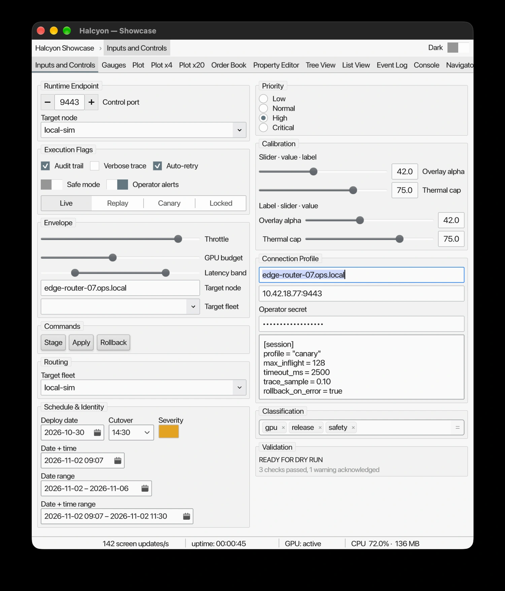
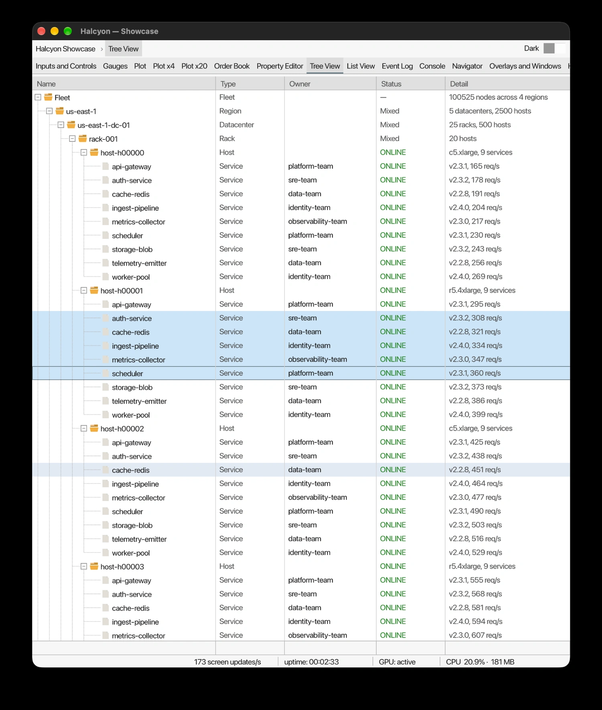
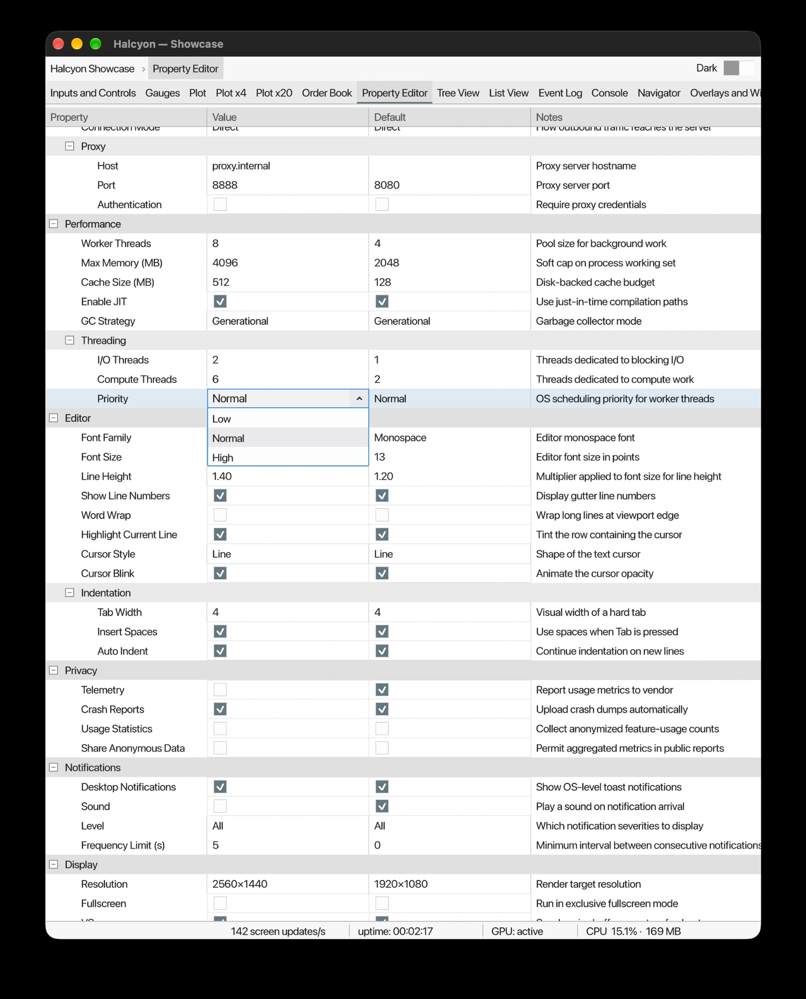

### A retained-mode, GPU-accelerated UI framework for Rust.

Halcyon is designed for native and browser applications, from ordinary interfaces to complex, data-intensive workspaces. No high-end GPU is required for everyday UI.

[Website](https://halcyon-framework.org/) · [Live Showcase](https://halcyon-framework.org/showcase) · [Documentation](docs/guide/index.md) · [crates.io](https://crates.io/crates/halcyon-rs)

<table>
  <tr>
    <td align="center" valign="top" width="33%">
      <a href="docs/images/readme/showcase-inputs-and-controls.webp"></a><br>
      <sub>Inputs and Controls</sub>
    </td>
    <td align="center" valign="top" width="33%">
      <a href="docs/images/readme/showcase-tree-view.webp"></a><br>
      <sub>Tree View</sub>
    </td>
    <td align="center" valign="top" width="33%">
      <a href="docs/images/readme/showcase-property-editor.webp"></a><br>
      <sub>Property Editor</sub>
    </td>
  </tr>
</table>

Halcyon is currently an experimental beta. Public APIs and integration requirements can change between releases.

## Getting started

Run Showcase from the Halcyon source root:

```sh
cargo run --locked -p halcyon-rs --example showcase
```

The published Rust package is [halcyon-rs](https://crates.io/crates/halcyon-rs), and the library is named `halcyon`. See crates.io for the current beta and installation command.

Import windowing types through `halcyon::winit` to use the framework's windowing dependency on both native and WebAssembly targets.

- [Getting started](docs/guide/getting-started.md)
- [Documentation index](docs/guide/index.md)
- [Design philosophy and architectural rationale](docs/guide/design-rationale.md)
- [Roadmap](ROADMAP.md)
- [Web Showcase](examples/web_showcase/README.md)
- [Web Touch Input](examples/web_touch_input/README.md)

## Platform support

Halcyon has been developed and tested primarily on macOS, with Windows 10 being the second most extensively tested platform.

Linux has received comparatively little testing so far. This is a known limitation of the current beta, and broader cross-platform testing and validation remain important areas for further development.

## Development history

Halcyon has been in active development since November 2025. It was originally developed for my own use, with no plans for a public release. Its development priorities were driven by the needs of my own projects. The decision to make it open source came much later.

This repository marks the transition from private development to open source, rather than the beginning of the project. The original development history is preserved privately because it includes internal engineering material and development infrastructure not intended for public distribution.

See [HISTORY.md](HISTORY.md) for the chronological record of development before the public release.

## Participation

Halcyon is developed and maintained by its founder, [Andrey Gubarev](https://github.com/agubarev), with extensive AI assistance. It has one human maintainer. Architectural decisions and responsibility for the official implementation remain with the founder.

Bug reports, reproducible examples, technical questions, criticism, and proposals are welcome through Issues. External pull requests are not accepted, and there is no scheduled date for changing this policy.

Read the [FAQ](docs/guide/faq.md) for the development model, participation rules, licensing status, and verified project boundaries.

See [CONTRIBUTING.md](CONTRIBUTING.md) for participation rules and [CODE_OF_CONDUCT.md](CODE_OF_CONDUCT.md) for community conduct. For vulnerability reporting, see [SECURITY.md](SECURITY.md).

## License

Halcyon is licensed under the [MIT License](LICENSE). Bundled third-party code and assets retain their own licenses; see [Third-party notices](docs/THIRD-PARTY-NOTICES.md).

## Support Halcyon

If you would like to support the ongoing development and maintenance of Halcyon, you can do so through [GitHub Sponsors](https://github.com/sponsors/agubarev).

Sponsorship is voluntary and does not confer influence over project decisions, priority support, or a commitment to deliver particular features.
