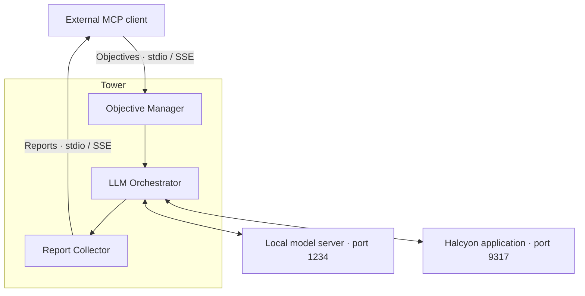

# SPEC-HAL-318: **Tower — Agent Orchestration Daemon**

### *Local LLM Orchestrator for Autonomous UI Testing and Exploration*

**Author:** JC
**Status:** Draft
**Depends on:**

* SPEC-HAL-317 (Agent Integration Architecture)
* SPEC-HAL-317A (Semantic Agent Events)

---

# 1. Purpose

Tower is Halcyon's built-in agent orchestration module. It
bridges a running Halcyon application to a local LLM, enabling
autonomous UI exploration, testing, and reporting under an external
MCP client's supervision.

Tower is a system module, not an example. Any Halcyon app
can spawn Tower as part of its runtime configuration.

---

# 2. Architecture



The orchestrator owns prompt construction, JSON validation and retry,
context management, model routing and idle work.

---

# 3. Core Principles

**CP-318-1: Tower is a system module.**
Lives in `src/agent/tower.rs`. Any Halcyon app can spawn
it via `AppConfig` or programmatically. Not an example,
not a standalone binary — a reusable framework component.

**CP-318-2: The local LLM is Tower's hands, not its brain.**
Tower manages the local model's limitations: retries on
bad JSON, context windowing, model selection. The local
model executes; Tower orchestrates.

**CP-318-3: Claude supervises via MCP, never directly controls.**
Claude issues high-level objectives ("test keyboard nav on
PropertyEditor"). Tower translates to system prompts,
runs the local model, collects findings, reports back.
Claude never talks to the local model directly.

**CP-318-4: Reports are structured, not raw.**
Tower compresses thousands of events into actionable
findings. Claude reads summaries, not firehoses.

---

# 4. Module Structure

```
src/agent/
    mod.rs              — re-exports
    tower.rs           — Tower orchestrator
    llm_client.rs       — OpenAI-compatible HTTP client
    objective.rs        — Objective types and lifecycle
    report.rs           — Finding collection and reporting
    prompt.rs           — System prompt templates
```

---

# 5. API

## 5.1 Configuration

```rust
pub struct TowerConfig {
    /// LM Studio API endpoint.
    pub llm_url: String,

    /// Preferred model name (sent to LM Studio).
    /// None = use whatever is loaded.
    pub model: Option<String>,

    /// Halcyon agent WebSocket URL.
    pub halcyon_ws: String,

    /// Temperature for LLM calls. Low = deterministic.
    pub temperature: f32,

    /// Max tokens per LLM response.
    pub max_tokens: u32,

    /// Delay between agent actions (ms). Human-like pacing.
    pub action_delay_ms: u64,

    /// Max exchanges per objective before timeout.
    pub max_exchanges: u32,

    /// Idle poke threshold — poke after N empty rounds.
    pub idle_poke_threshold: u32,
}

impl Default for TowerConfig {
    fn default() -> Self {
        Self {
            llm_url: "http://localhost:1234/v1/chat/completions".into(),
            model: None,
            halcyon_ws: "ws://localhost:9317".into(),
            temperature: 0.1,
            max_tokens: 200,
            action_delay_ms: 120,
            max_exchanges: 50,
            idle_poke_threshold: 3,
        }
    }
}
```

## 5.2 Spawning

```rust
// From AppConfig — automatic setup
let app = App::new(
    AppConfig::new("My App")
        .with_agent_server(9317)
        .with_tower(TowerConfig::default()),
);

// Or programmatically — separate thread
let tower = Tower::new(TowerConfig::default());
let handle = tower.spawn();  // returns TowerHandle
```

## 5.3 Objectives

```rust
pub enum Objective {
    /// Free exploration — poke everything, report what you find.
    Explore {
        duration_seconds: u32,
    },

    /// Keyboard navigation audit — verify all widgets are
    /// reachable via Tab, report unreachable ones.
    KeyboardAudit,

    /// Type invalid data in every editable field, report
    /// validation behavior.
    ValidationAudit,

    /// Execute a specific action sequence and report results.
    Script {
        description: String,
        steps: Vec<String>,
    },

    /// Custom objective — freeform instruction to the LLM.
    Custom {
        instruction: String,
    },
}
```

## 5.4 Findings

```rust
pub struct TowerReport {
    pub objective: String,
    pub duration_ms: u64,
    pub total_actions: u32,
    pub total_events: u32,
    pub findings: Vec<Finding>,
}

pub struct Finding {
    pub severity: Severity,
    pub category: FindingCategory,
    pub description: String,
    /// Widget ID if applicable.
    pub widget_id: Option<u64>,
    /// The action that triggered this finding.
    pub trigger_action: Option<String>,
    /// The event that revealed this finding.
    pub trigger_event: Option<String>,
}

pub enum Severity {
    Info,       // Observed behavior, nothing wrong
    Warning,    // Unexpected but not broken
    Error,      // Something is broken
}

pub enum FindingCategory {
    Navigation,     // Focus, tab order, unreachable widgets
    Input,          // Text entry, capture mode issues
    Validation,     // Validation errors, missing validation
    Rendering,      // Visual artifacts (if detectable from events)
    Interaction,    // Click, hover, state change issues
    Performance,    // Slow frames, long layout times
}
```

---

# 6. LLM Orchestration

## 6.1 JSON Babysitting

The local model may return malformed output. Tower handles:

- **Markdown fences:** strip ```json ... ```
- **Preamble text:** extract JSON from "Sure! Here's the action: {...}"
- **Invalid JSON:** retry with "Your last response was not valid JSON. Respond with ONLY a JSON object."
- **Wrong schema:** action deserializes but has unknown fields → retry with schema reminder
- **Empty response:** poke with "You returned an empty response. Send a JSON action."
- **Max retries:** 3 attempts per exchange. If all fail, log as a finding and move on.

## 6.2 Context Management

- **System prompt:** constant, ~300 tokens. Describes available actions + current objective.
- **Conversation history:** rolling. Keep last 20 exchanges in full. Older exchanges compressed to summaries.
- **State snapshots:** periodically inject "Current state: focused widget is X, visible fields are Y, Z."
- **Context budget:** if messages exceed 4000 tokens, compress oldest half into a one-paragraph summary.

## 6.3 Model Routing (Future)

When multiple models are available:

- **Simple navigation** (Tab, Enter, Escape) → smallest model (Gemma 4B)
- **Text generation** (type meaningful values) → medium model (Qwen 9B)
- **Complex reasoning** (analyze patterns, explain findings) → large model (Qwen 35B MoE)

Initial implementation: single model, no routing.

## 6.4 Idle Poke

When no events arrive for `idle_poke_threshold` consecutive rounds:

```
"You've been idle. Reflect on what you've explored and try
something different. Navigate to a widget you haven't tried.
Send your next action."
```

---

# 7. MCP Interface

Tower exposes MCP tools for the supervising client:

```
tower:status
    → { connected: bool, model: "qwen3.5-9b", app: "Agent Demo", idle: false }

tower:run_objective(objective: Objective)
    → { report_id: "uuid" }
    Starts an objective. Non-blocking — returns immediately.

tower:get_report(report_id: str)
    → TowerReport
    Returns the report once the objective completes.

tower:list_reports
    → Vec<ReportSummary>

tower:poke(message: str)
    → Injects a freeform message into the LLM conversation.
    For ad-hoc steering mid-objective.

tower:stop
    → Stops the current objective. Collects partial report.

tower:query_ui(question: str)
    → Asks the local model to describe what it sees.
    Returns the model's description (not structured — freeform).
```

MCP transport: stdio (for Claude Code integration) or SSE
(for Claude.ai / remote access). Configuration selects which.

---

# 8. Integration with AppConfig

```rust
impl AppConfig {
    /// Enable Tower agent orchestrator.
    /// Automatically enables agent_server if not already enabled.
    pub fn with_tower(mut self, config: TowerConfig) -> Self {
        if self.agent_server_port.is_none() {
            self = self.with_agent_server(9317);
        }
        self.tower_config = Some(config);
        self
    }
}
```

Tower spawns on a dedicated thread during `App::run`,
after the agent server is started. It connects to the
agent server's WebSocket like any external agent.

---

# 9. Invariants

**INV-318-1:** Tower communicates with Halcyon exclusively
through the agent WebSocket. No direct access to WidgetTree,
AppState, or internal types. Same channel as any external agent.

**INV-318-2:** The local LLM never receives raw Halcyon
internals (WidgetIds, NodeIds, layout rects). Tower
translates between the structured agent protocol and the
LLM's natural language understanding.

**INV-318-3:** Objectives are bounded. Every objective has
a max exchange count. Tower never runs unbounded.

**INV-318-4:** MCP tools are non-blocking. `run_objective`
returns immediately with a report ID. The objective runs
on Tower's worker thread.

---

# 10. Forbidden Behaviors

**FORBID-318-1:** Tower MUST NOT bypass the agent WebSocket.
No direct library calls to Halcyon internals. Tower is an
external observer, not a privileged system component.

**FORBID-318-2:** Tower MUST NOT expose raw LLM responses
through MCP without validation. All actions sent to Halcyon
must be valid `AgentAction` JSON. Malformed LLM output is
retried or discarded, never forwarded.

**FORBID-318-3:** Tower MUST NOT persist conversation
history to disk. State is in-memory only. Session ends
when the app exits.

---

# 11. Implementation Phases

**Phase 1:** Module skeleton + LLM client.
`src/agent/mod.rs`, `llm_client.rs`, `tower.rs`.
Refactor `agent_lm_bridge.rs` logic into the module.
`TowerConfig`, `Tower::new()`, `Tower::spawn()`.

**Phase 2:** Objective system.
`objective.rs`, `report.rs`. Structured objectives,
finding collection, report generation.

**Phase 3:** MCP server.
Expose Tower tools via MCP. stdio transport first.

**Phase 4:** JSON babysitting + context management.
Retry logic, markdown stripping, context compression,
idle poke.

**Phase 5:** AppConfig integration.
`with_tower()` on AppConfig. Auto-spawn during App::run.

---

# 12. Naming

Tower explores the application, exercises its controls and reports failures.
The supervising client supplies objectives and reviews the resulting evidence.
